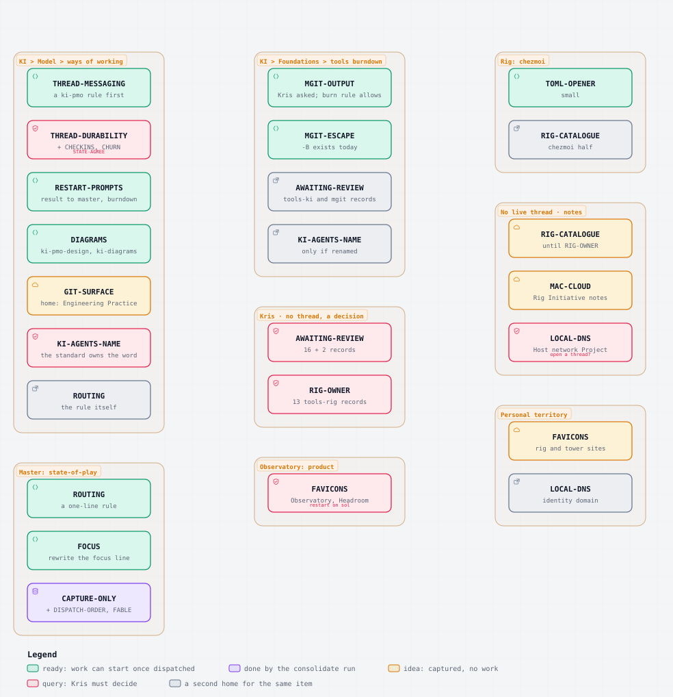
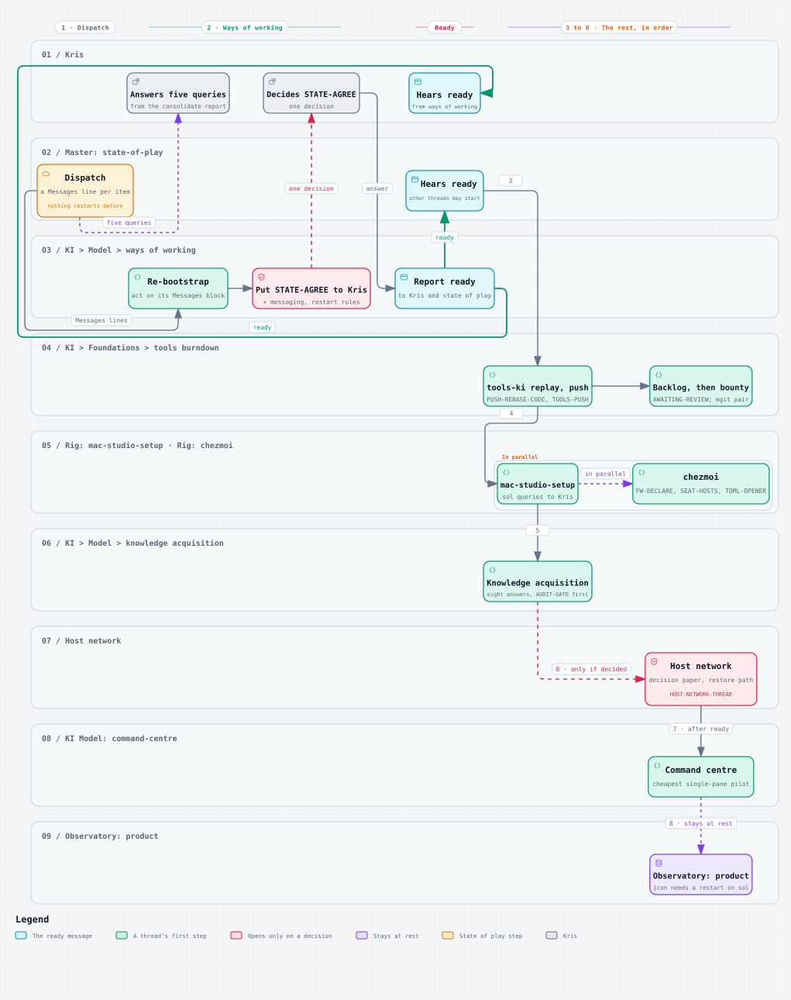

# State of play · the 17 October intake in four pictures

Four diagrams drawn from the consolidate report and the 17 October decisions: where each intake item sits, where it goes, which items are one concern, and the order the threads restart in. They draw what the report says and add nothing. Sources and SVGs live in `themes/`.

## 1 · Theme map

Initiatives are the outer frames, Projects the inner frames with their thread's state, workstreams the boxes with the intake tags they hold. A box tagged `new` is a workstream the consolidation found missing from the Project note. The master's own rules and the two personal-territory items sit outside any Project.

## 2 · Routing

Each item under the thread that receives it, or under Kris, a Project note or the personal territory where no live thread can take it. Colour is the kind of handoff: ready, query, idea or done. A grey box is an item's second home.

## 3 · Overlaps

Four clusters the consolidation names as one concern each, with the single place each cluster lands.

## 4 · Restart sequence

State of play dispatches first and nothing restarts before that. Ways of working re-bootstraps, puts STATE-AGREE with the messaging and restart-prompt rules to Kris as one decision, then tells Kris and state of play that the other threads may start. Tools burndown follows, then the Rig threads in parallel, knowledge acquisition, Host network only on a decision, command centre after ready, and Observatory: product stays at rest.

